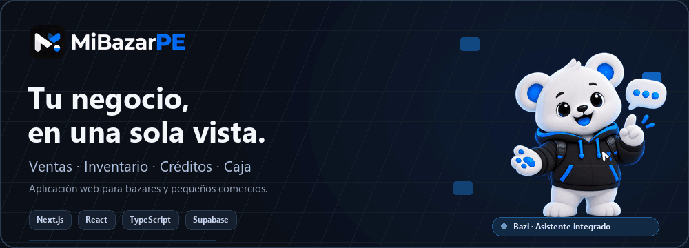
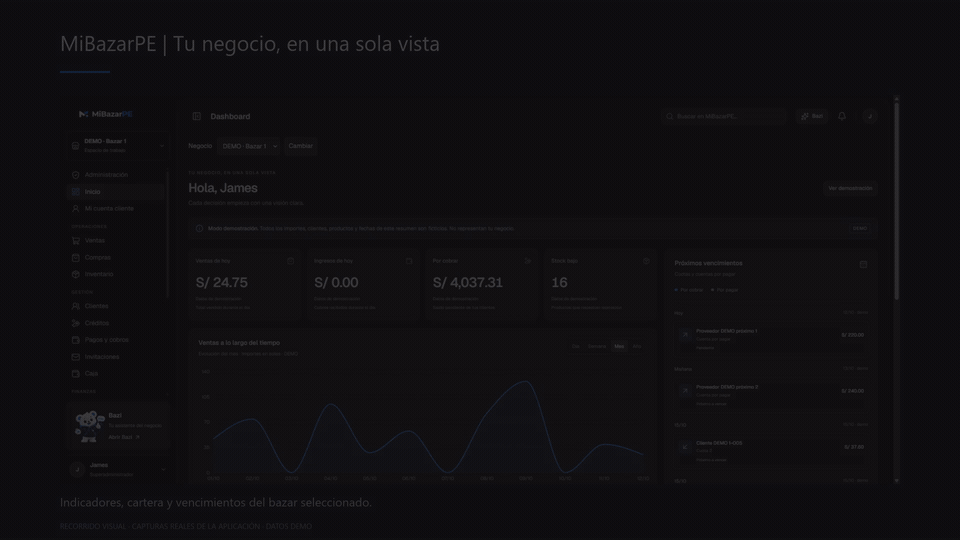
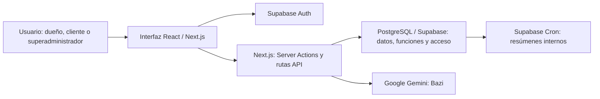

<p align="center">
  <picture>
    <source media="(prefers-reduced-motion: reduce)" srcset=".github/readme/portada.png">
    
  </picture>
</p>

<h1 align="center">MiBazarPE</h1>

<p align="center">
  <strong>Controla tu bazar. Vende y cobra. Decide mejor.</strong><br>
  Aplicación web para conectar las operaciones de un pequeño negocio en un solo lugar.
</p>

<p align="center">
  <a href="https://mibazarpe.netlify.app/"><strong>Abrir la aplicación ↗</strong></a>
  &nbsp; · &nbsp;
  <a href="#recorrido-visual">Ver el recorrido</a>
  &nbsp; · &nbsp;
  <a href="#ejecutar-en-local">Ejecutar en local</a>
  &nbsp; · &nbsp;
  <a href="#equipo">Conocer al equipo</a>
</p>

---

## ¿De qué trata este proyecto?

MiBazarPE es un proyecto académico de Ingeniería de Sistemas de Información de la **Universidad Peruana de Ciencias Aplicadas (UPC)**, orientado a la gestión de bazares y pequeños comercios.

Reúne **ventas, productos, inventario, clientes, créditos, cuotas, cobros, compras y caja**. Su propósito es que el dueño pueda seguir una operación desde que vende un producto hasta que recibe el pago, sin reconstruir la información entre cuadernos y hojas de cálculo separadas.

El proyecto incluye una landing pública, acceso con autenticación, un área de gestión por negocio, un portal para clientes y **Bazi**, un asistente integrado con Google Gemini.

### El problema que buscamos resolver

- **Información dispersa:** ventas, existencias y pagos anotados en distintos lugares.
- **Poca claridad sobre el stock:** dificultad para identificar productos agotados o próximos a reponerse.
- **Créditos difíciles de seguir:** cuotas, intereses, vencimientos y saldos pendientes sin una vista común.
- **Confusión entre vender y cobrar:** una venta a crédito no equivale a dinero recibido en caja.
- **Trabajo repetitivo:** volver a digitar catálogos o buscar manualmente los compromisos del negocio.

El usuario principal es el **dueño del bazar**. Sus clientes acceden a un portal para consultar sus propias compras y obligaciones; no reciben acceso al inventario ni a las finanzas generales del establecimiento.

## Recorrido visual

<p align="center">
  <a href="https://mibazarpe.netlify.app/">
    <picture>
      <source media="(prefers-reduced-motion: reduce)" srcset=".github/readme/recorrido.jpg">
      
    </picture>
  </a>
</p>

<p align="center"><sub>Extracto de una grabación del producto con datos ficticios. La interfaz continúa evolucionando; el recorrido no representa operaciones de un negocio real.</sub></p>

**Para explorar:** abre la [web publicada](https://mibazarpe.netlify.app/) y pulsa **Ver demostración** en la landing. Para gestionar un establecimiento, crea una cuenta de dueño y registra tu negocio. El acceso al portal de cliente se vincula mediante invitación.

## ¿Qué puedes hacer?

### 01 · Entender el estado del negocio

El dashboard reúne ventas del día, ingresos recibidos, cuentas por cobrar y alertas de stock. Incluye vistas de resumen, análisis y agenda, gráficos por período y próximos vencimientos. Cada indicador conserva su alcance: cambiar el período de una gráfica no convierte automáticamente todos los indicadores en totales del mismo período.

### 02 · Gestionar productos e inventario

Registrar y consultar productos, editar su ficha, definir precios al contado y a crédito, controlar el stock mínimo y adjuntar fotografías desde su ficha. Los productos creados manualmente empiezan con stock cero; las entradas se registran mediante compras.

### 03 · Registrar ventas y hacer seguimiento al crédito

Preparar ventas al contado o a crédito, revisar su previsualización y confirmar la operación. El módulo de crédito contempla condiciones por cliente, simulación, cronogramas, cuotas y seguimiento de saldos, con separación de capital, interés y mora.

### 04 · Organizar clientes, cobros y proveedores

Mantener fichas comerciales, consultar cuentas por cobrar, registrar cobros y seguir compras y cuentas por pagar a proveedores. Las operaciones financieras utilizan funciones del servidor y de PostgreSQL para aplicar las reglas del negocio.

### 05 · Revisar caja y reportes

Consultar movimientos de caja, liquidaciones y reportes del establecimiento. Las vistas de operaciones incluyen búsqueda y, según el módulo, filtros, paginación y exportación de la página consultada.

### 06 · Importar un catálogo con revisión previa

El importador guía la carga de **productos o clientes**: elegir archivo, asignar columnas, revisar errores y confirmar antes de guardar. Admite XLSX, XLS, ODS, CSV, TSV, TXT delimitado y JSON tabular, con un máximo de **2 MB y 500 registros por importación**.

No importa deudas ni ventas históricas desde una hoja genérica. Los archivos con fórmulas deben convertirse primero a valores.

## Bazi · Asistencia dentro de la aplicación

Bazi utiliza **Google Gemini**, datos autorizados del negocio y herramientas ejecutadas en el servidor. Puede ayudar a:

- Consultar resúmenes, ventas, inventario y próximos compromisos.
- Buscar productos y clientes dentro del negocio activo.
- Preparar propuestas de cambios de precios o stock mínimo.
- Preparar ventas para revisar y confirmar.
- Proponer rutinas de resúmenes y notas de contexto que el usuario puede aprobar.

Las propuestas que modifican información requieren **confirmación** y vuelven a validar sesión, rol y pertenencia al negocio. El cliente recibe herramientas limitadas a su cuenta vinculada.

Las rutinas generan resúmenes internos de stock o vencimientos mediante Supabase Cron. **No envían mensajes externos ni registran ventas o pagos automáticamente.**

La memoria de Bazi consiste en notas aprobadas y recuperadas como contexto; no implica entrenar un modelo desde cero ni modificar los pesos de Gemini. Su disponibilidad depende de la configuración privada, la cuota del proveedor y la autorización de uso del usuario.

Más información: [configuración y alcance de Bazi](BAZI_SETUP.md).

## Roles y acceso

- **Superadministrador (`SUPERADMIN`):** supervisa negocios, usuarios y accesos de la plataforma. No se asigna mediante el registro público.
- **Dueño de bazar (`DUENO_BAZAR`):** registra y gestiona su establecimiento, catálogo, clientes y operaciones según su pertenencia activa.
- **Cliente (`CLIENTE`):** consulta sus compras, cuotas y pagos vinculados. Una ficha comercial de cliente y una cuenta de acceso son conceptos distintos; la invitación permite vincularlos.

La aplicación distingue los **datos reales** de los escenarios **DEMO**, identificados como ficticios. Los ejemplos del README no son métricas comerciales ni testimonios de clientes reales.

## CRUD aplicado al proyecto

Los módulos de **productos y clientes** permiten explicar las operaciones básicas de gestión:

- **Create:** registrar un producto o una ficha de cliente.
- **Read:** listar, buscar y abrir el detalle del registro.
- **Update:** editar datos, precios o estados permitidos.
- **Baja lógica:** marcar el registro como inactivo, conservando su historial y relaciones.

La baja lógica es la alternativa de este proyecto al borrado físico de esas fichas. Las ventas, cuotas y pagos se gestionan con reglas financieras específicas; no se presentan como registros que puedan borrarse libremente.

## Tecnologías y su función

- **Next.js 16 + React 19:** páginas, navegación, componentes de la interfaz y ejecución de acciones del servidor.
- **TypeScript:** contratos y tipos para los datos, formularios y módulos.
- **Tailwind CSS 4 + CSS Modules:** estilos, temas y diseño adaptable.
- **shadcn/ui + Radix UI + Lucide:** controles reutilizables, diálogos, menús e iconos.
- **Motion + Recharts:** transiciones de interfaz y visualización de indicadores.
- **Supabase + PostgreSQL:** autenticación, persistencia relacional, funciones SQL/RPC, políticas de acceso, almacenamiento de imágenes y rutinas programadas.
- **Google Gemini:** modelo utilizado por Bazi desde el servidor.
- **SheetJS:** lectura de libros de cálculo en el importador.
- **hCaptcha + Brevo:** verificación de formularios y servicios de correo, según configuración.
- **Netlify + GitHub:** publicación de la aplicación y control de versiones.

Las versiones exactas están en [`package.json`](package.json) y [`package-lock.json`](package-lock.json).

## ¿Cómo se conectan las piezas?



Next.js contiene la interfaz y la capa de servidor. Las acciones validan el contexto antes de consultar o modificar información; PostgreSQL conserva las relaciones y reglas de las operaciones. La integración de Gemini utiliza herramientas acotadas, no acceso libre a la base de datos.

### Estructura principal

```text
src/
  app/                 Páginas públicas, autenticación, área privada y rutas API
  components/          Componentes de interfaz, marketing y módulos de la aplicación
  features/
    auth/              Acceso y validación de autenticación
    access/            Negocios, invitaciones y pertenencia
    dashboard/         Contexto y presentación del resumen del negocio
    operations/        Ventas, compras, productos, clientes y mantenimiento
    imports/           Lectura, validación e importación de catálogos
    bazi/              Conversaciones, herramientas, propuestas y persistencia
  infrastructure/      Integraciones, incluidos los clientes de Supabase
supabase/
  migrations/          Cambios SQL versionados
  seeds/               Datos de demostración
  templates/           Plantillas de correo de autenticación
tests/                 Pruebas automatizadas
public/                Marca, imágenes y recursos del producto
```

## Ejecutar en local

### Requisitos

- Node.js **24** y npm **11**, alineados con la configuración del proyecto.
- Un proyecto de Supabase autorizado con el esquema, las funciones y las políticas requeridas.
- Variables de entorno propias para las integraciones que se vayan a utilizar.

### Instalación

```bash
git clone https://github.com/JamesLM1/MiBazarPE.git
cd MiBazarPE
npm ci
```

Copia [`.env.example`](.env.example) como `.env.local`. En PowerShell:

```powershell
Copy-Item .env.example .env.local
```

Completa la configuración de tu propio entorno. Para Supabase, revisa `NEXT_PUBLIC_SUPABASE_URL` y su clave pública; para activar Bazi se requieren `GEMINI_API_KEY`, `GEMINI_MODEL` y `BAZI_ACTION_SECRET`. Correo, captcha y otras integraciones tienen sus propias variables en la plantilla.

```bash
npm run dev
```

Abre [http://localhost:3000](http://localhost:3000).

> Instalar dependencias no crea automáticamente la base de datos ni habilita los proveedores externos. Las migraciones versionadas deben revisarse y aplicarse en un entorno autorizado; no deben ejecutarse a ciegas contra una base existente. Nunca uses las credenciales de otra persona ni copies las de producción al README.

### Comandos disponibles

```bash
npm run dev        # Desarrollo local
npm run typecheck  # Comprobación de tipos
npm test           # Pruebas automatizadas
npm run lint       # Revisión de estilo del repositorio
npm run build      # Compilación de producción
npm run start      # Iniciar la compilación de producción
```

## Publicación y seguridad

La aplicación está publicada en **[mibazarpe.netlify.app](https://mibazarpe.netlify.app/)**. La configuración de Netlify ejecuta las pruebas y la compilación; la conexión con GitHub permite actualizar la web al publicar cambios en `main`.

- Las claves privadas pertenecen a `.env.local` o al administrador de variables del alojamiento.
- Ningún secreto de servidor debe llevar el prefijo `NEXT_PUBLIC_` ni guardarse en Git.
- El acceso combina sesión, rol, pertenencia al negocio y políticas de PostgreSQL; la autorización no se basa únicamente en ocultar botones.
- Las propuestas de Bazi no sustituyen las reglas financieras ni los permisos existentes.
- Las demostraciones utilizan datos ficticios y se identifican como tales.

**Estado:** proyecto académico en evolución, con funcionalidades implementadas y una versión publicada para exploración. Continúan las mejoras de experiencia, compatibilidad y rendimiento.

## Equipo

MiBazarPE es un trabajo de equipo con participación en desarrollo, diseño, análisis y documentación:

- [James Lucas Moreto](https://github.com/JamesLM1)
- [Jairo Jalil Antonino Rodriguez Espinoza](https://github.com/JJARE1611)
- [Luis Diego Camus Dominguez](https://github.com/LuisCamus19)
- [Diego Alexander Aguirre Gutierrez](https://github.com/DiegoAguirre29)
- [Oscar Enrique Valderrama Bautista](https://github.com/OscarV123/OscarV123)
- Alex Oswaldo Villarroel Antonio

Los créditos detallados se presentan en la sección **Nosotros** de la aplicación. Los recursos de terceros conservan sus licencias y atribuciones correspondientes.

---

<p align="center"><strong>MiBazarPE · Tu negocio, en una sola vista.</strong><br><a href="https://mibazarpe.netlify.app/">Explorar la aplicación ↗</a></p>
